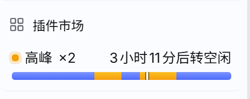

# dsh-peak-hours

一个 DeepSeek Harness 的侧栏角标：**现在是不是高峰计价时段**。



## 它显示什么

挂在侧栏底部动作行（`sidebar.footer.action`，「插件市场」下面），一行搞定三件事：

- **状态**：橙点 = 高峰，蓝点 = 空闲；后面跟倍率（`×2` / `×1`）
- **倒计时**：还有多久切换（`3小时11分后转空闲`）
- **全天日程条**：00:00–24:00 一条 8px 高的条，橙色段是高峰、蓝色段是空闲，白色竖线是当前时刻——一天里什么时候贵，一眼看全

侧栏折叠成窄轨时自动退化为「圆点 + 一小截进度条」，不占地方。

鼠标悬停能看到完整说明：当前段起止时间、下一段是什么、以及高峰/空闲的价格表。

## 计费规则

按 DeepSeek 的峰谷定价：

- **高峰**：北京时间 **09:00–12:00**、**14:00–18:00**
- **空闲**：其余时间（含午间 12:00–14:00、18:00 之后、09:00 之前）
- **整天空闲**：周六、周日，以及中国的法定节假日
- 闲时价 = 高峰价的一半

节假日表是**内置的，不联网**：目前覆盖 2026 年（中秋 9/25–27、国庆 10/1–7）。2026 年 9/20（周日）和 10/10（周六）是调休上班日，按规则仍算空闲。表里没有的年份退化成「周末空闲」规则——这不是想当然，是保守起见的选择，遇到新的节假日安排需要更新 `client.js` 里的 `HOLIDAYS`。

时间一律按北京时间（UTC+8）算，和你浏览器的时区无关。

## 安装

从 npm（已发布后）：

```sh
dsh plugin --profile web add dsh-peak-hours
```

从本地目录：

```sh
dsh plugin --profile web add /绝对路径/dsh-peak-hours
```

装完刷新页面（或重启 `dsh web`）即可生效。

## 卸载

```sh
dsh plugin --profile web remove dsh-peak-hours
```

## 兼容性

- 需要带客户端 UI 的 DeepSeek Harness Web GUI（`dsh.client` 声明为 `platform: web`）
- 纯客户端插件：不注册 host 工具、不写文件、不发网络请求、不需要任何配置或凭据
- 颜色是固定值（高峰 `#f59e0b`、空闲 `#4d6bfe`，即 DeepSeek 品牌蓝），不跟随主题 `brand-primary`，以免换皮肤后蓝色被改成别的色

## 许可

MIT
